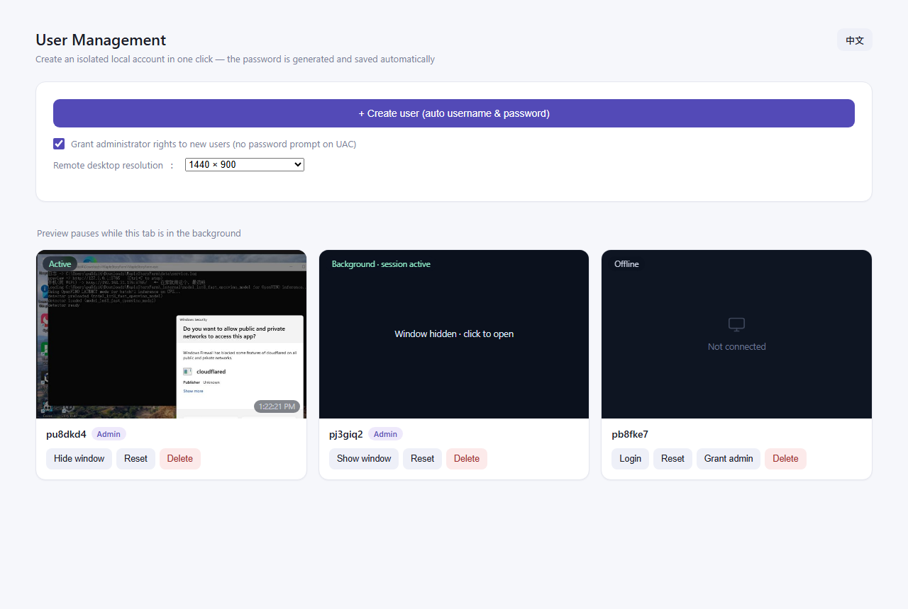

# MultiRDP · Multi-user Remote Desktop Manager for Windows

**English** | [简体中文](README.md)

Create multiple isolated local Windows accounts in one click, each with its own remote desktop
window, and manage everything from a **system-tray resident** app. Built for running several
isolated environments on a single PC — game multi-boxing, test environments, giving family or
colleagues their own desktop, and so on.



> The button at the top right switches between English and Chinese instantly
> (Chinese UI: [docs/screenshot_webui.png](docs/screenshot_webui.png)).

> UI overview: **Create user** generates a random account name + strong password automatically;
> **Login** opens a separate FreeRDP window against `127.0.0.1`; **Reset** signs the session out
> (useful when the desktop freezes); **Delete** removes the account, profile folder and registry
> leftovers.

## Features

- **One-click user creation** — random username (`p` + 6 chars, ambiguous characters avoided),
  14-char strong password, automatically added to `Remote Desktop Users`, optionally to
  `Administrators` (so UAC only needs a click instead of a password)
- **One-click login** — launches FreeRDP against `127.0.0.1`, one window per user; prefers
  `sdl3-freerdp.exe` (correct rendering) and falls back to `wfreerdp.exe` / `mstsc`
- **Session reset** — logs the user's session off to recover from a black/frozen screen; the
  next login starts a fresh desktop
- **Clean user deletion** — logoff → delete account → delete profile via WMI → force-remove
  leftover folders → clean the `ProfileList` registry key → verify; incomplete deletions stay
  listed as "leftover" and can be retried
- **Orphan folder scan** — leftover profile folders created by this tool are re-listed so they
  can be cleaned up
- **White-screen repair** — detects whether OpenStreamMS hijacked the RDP graphics pipeline
  (`RDP-Tcp\LoadableProtocol_Object`) and restores the Microsoft protocol with one click
- **Tray resident** — `MultiRDP.exe` runs in the tray with a menu: Open Web UI / default-admin
  toggle / Exit
- **Bilingual UI (English / Chinese)** — one-click switch at the top right; the choice is stored
  in `config.json` (`lang`) and API error messages follow the same language

## Quick start

Requirements: Windows 10/11 x64, Python 3.9+, administrator rights.

### Option 1 — double-click to run (debug)

```text
scripts\run.bat
```

Self-elevates via UAC, starts the web UI in console mode and opens
<http://127.0.0.1:8123>. Closing the window stops the server; logs are visible in the console.

### Option 2 — build a single exe (tray resident)

```text
scripts\build.bat
```

Produces `dist\MultiRDP.exe` (PyInstaller, one file, no console window). First run:

1. Copy the whole `bin\FreeRDP\` folder to `dist\FreeRDP\`
2. Double-click `dist\MultiRDP.exe` (it requests administrator rights) — it stays in the tray
3. Right-click the tray icon → Open Web UI

### Option 3 — plain Python

```powershell
python src\webui\server.py
```

## Project layout

```text
multi-rdp/
├── src/
│   ├── tray_app.py          # tray app entry point (pystray)
│   └── webui/
│       ├── server.py        # web UI + user management core (127.0.0.1:8123)
│       ├── screencap.py     # pure-ctypes GDI screenshot helper
│       ├── config.json      # UI config (admin_default / lang)
│       └── users.json.example  # user DB template (real users.json is ignored)
├── 3rd/
│   └── TermWrap.dll         # multi-session patch (prebuilt 423 KB, ready to use)
├── bin/                     # prebuilt tools (usable as-is, no build needed)
│   ├── FreeRDP/             # sdl3-freerdp.exe / wfreerdp.exe + license
│   ├── patchtest.exe        # offline patch self-test (27 signature checks)
│   └── patchlive.exe        # live patcher (patches TermService without reboot)
├── scripts/
│   ├── run.bat              # double-click run/debug
│   ├── build.bat            # package single exe
│   ├── fix_termwrap.bat     # persist ServiceDll (effective after reboot)
│   ├── rollback_termwrap.bat# restore the original ServiceDll
│   ├── check_termwrap.ps1   # check TermWrap load state / concurrent sessions flag
│   ├── grant_admin.*        # bulk-grant admin rights to existing remote users
│   └── remove_profile.bat   # force-remove a leftover profile folder
└── docs/                    # screenshots and docs assets
```

## Multi-session patch (TermWrap)

Windows client editions allow only one remote session. `TermWrap.dll` runtime-patches
`termsrv.dll` to lift that limit, enabling **several users online at the same time**.

- Prebuilt dll: `3rd/TermWrap.dll` — ready to use, **no local build required** (sources are not distributed with this repo)

Two ways to enable it:

| Mode | Action | Notes |
| --- | --- | --- |
| Persistent | `scripts\fix_termwrap.bat` | Points TermService `ServiceDll` at TermWrap.dll; effective after reboot. `rollback_termwrap.bat` reverts it |
| Live patch | `bin\patchlive.exe` | Patches the running TermService process in memory — no reboot, no service restart |

Verify with `scripts/check_termwrap.ps1`: ServiceDll value, modules loaded by the TermService
process, the `EnableConcurrentSessions` flag, and the current session list.

> Key registry value: `HKLM\SYSTEM\CurrentControlSet\Services\TermService\Parameters\ServiceDll`.
> The original value is backed up to `C:\Users\Public\termwrap_backup.json` by
> `fix_termwrap.ps1`.

## About FreeRDP

`bin/FreeRDP/` ships prebuilt FreeRDP clients (`sdl3-freerdp.exe`, `wfreerdp.exe`, ~22 MB in
total) so the project works out of the box. The FreeRDP source tree is large and is not vendored
here; build it yourself from <https://github.com/FreeRDP/FreeRDP> if needed. License:
`bin/FreeRDP/LICENSE.txt`.

## Security notes

- `users.json` stores managed users' **plaintext passwords** (needed for one-click login). It is
  excluded via `.gitignore` — never commit or share it. Only `users.json.example` is in the repo.
- The web UI binds to `127.0.0.1` only; it is not exposed to the LAN or internet.
- This tool creates/deletes local accounts and modifies profiles and the registry. **Use it only
  on machines you administer.**

## Tech stack

Python 3 (stdlib `http.server` + `ctypes`/`winreg`), pystray + Pillow (tray), PyInstaller
(packaging), FreeRDP (RDP client); the TermWrap multi-session patch ships as a prebuilt dll.

## License

[MIT](LICENSE)
