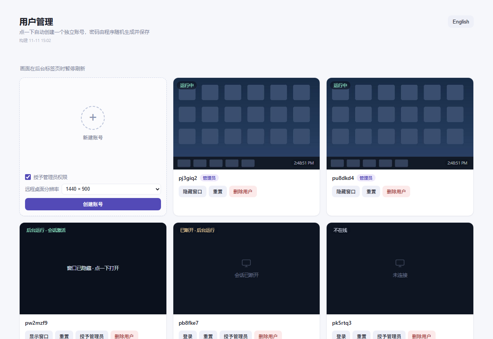

# MultiRDP · Windows 多用户远程桌面管理

[English](README.en.md) | **简体中文**

在 Windows 10/11 上快速创建多个互相隔离的本地账号，每个账号一键打开独立的远程桌面窗口，
并通过**系统托盘常驻**的小工具统一管理。适合在一台电脑上同时跑多个隔离环境（游戏多开、
测试环境、给家人/同事开独立桌面等）的场景。



> 界面右上角「English / 中文」可实时切换语言（英文界面效果见
> [docs/screenshot_webui_en.png](docs/screenshot_webui_en.png)）。

> 界面说明：点「创建用户」自动生成随机账号 + 强密码并保存；「登录」用 FreeRDP 连本机
> 127.0.0.1 打开独立远程桌面；「重置」注销会话（画面卡死时用）；「删除用户」彻底清理
> 账号、用户目录和注册表残留。

## 功能

- **一键创建用户**：随机用户名（`p` + 6 位，避开易混字符）、14 位强密码，自动加入
  `Remote Desktop Users`，可选加入 `Administrators`（UAC 只需点「是」）
- **一键登录**：调用 FreeRDP 连接 `127.0.0.1`，每个用户一个独立窗口；窗口建好后会自动
  翻到最上层并激活（客户端由后台进程拉起，没有前台权限，不主动置前就会躲在别的窗口后面）；
  用户已在运行时点「登录」等同于「把那个窗口带到前台」；
  自动选择渲染正常的 `sdl3-freerdp.exe`，回退 `wfreerdp.exe` / `mstsc`；
  分辨率可设置（自动窗口化：挑能完整放进屏幕的最大常用档，1080p 屏上是 1600x900；
  也可手动选具体档位，塞不进屏幕会自动等比缩小；只有明确选「全屏」才真全屏）
- **会话保持（窗口关掉、会话仍激活）**：点「隐藏窗口」只是把远程窗口藏起来，RDP 连接不断，
  所以会话一直是 `Active`——里面的程序照常渲染、继续持有焦点，任务栏和 Alt+Tab 里都看不到；
  点「显示窗口」原样回来。直接点窗口右上角的 X 会真的断开（会话变 `Disc`，此时没有输入通道，
  窗口拿不到真实焦点），程序会自动在后台重连一次把会话拉回 `Active`（保持窗口原来的显示状态，
  可见的还可见、隐藏的仍隐藏；`config.json` 里
  `keep_alive: false` 可关闭）。只有「重置」才会注销会话、结束所有程序。窗口归属和隐藏
  状态记在 `clients.json`，管理程序重启后会认回原来的窗口，「显示窗口」照样能用
- **会话重置**：注销该用户会话，解决黑屏/卡死；重置后重新登录即全新桌面
- **彻底删除用户**：注销会话 → 删除账号 → WMI 删用户配置 → 强删残留目录 →
  清理 `ProfileList` 注册表 → 校验结果；删不干净会保留条目并标记「残留」，可重试
- **孤儿目录扫描**：本工具生成的随机用户名目录若残留，会重新列在界面上供清理
- **修复登录白屏**：检测 OpenStreamMS 是否劫持了 RDP 图形管线
  （`RDP-Tcp\LoadableProtocol_Object`），一键还原为微软原版协议
- **托盘常驻**：`MultiRDP.exe` 后台运行，托盘菜单提供「打开 Web UI / 新用户默认授予管理员 / 退出」
- **中英双语界面**：右上角一键切换，选择保存在 `config.json`（`lang`），接口返回的错误提示同步切换

## 快速开始

环境要求：Windows 10/11 x64、Python 3.9+、管理员权限。

### 方式一：双击脚本运行（调试用）

```text
scripts\run.bat
```

自动请求管理员权限，以控制台模式启动 Web UI 并打开 <http://127.0.0.1:8123>。
关掉窗口即停止服务，日志直接显示在控制台。

### 方式二：打包成单个 exe（托盘常驻）

```text
scripts\build.bat
```

产物为 `dist\MultiRDP.exe`（PyInstaller，单文件、无控制台窗口）。脚本会顺带把 FreeRDP
客户端从 `3rd\FreeRDP\` 复制到 `dist\FreeRDP\`，无需手动操作。首次使用：

1. 双击 `dist\MultiRDP.exe`（自动请求管理员权限），程序驻留托盘
2. 托盘右键 → 打开 Web UI

### 方式三：直接跑 Python

```powershell
python src\webui\server.py
```

## 项目结构

```text
multi-rdp/
├── src/
│   ├── tray_app.py          # 托盘程序入口（pystray）
│   └── webui/
│       ├── server.py        # Web UI + 用户管理核心（127.0.0.1:8123）
│       ├── screencap.py     # 纯 ctypes GDI 截屏小工具
│       ├── config.json      # 界面配置（admin_default / lang / resolution）
│       └── users.json.example  # 用户库模板（真实 users.json 不入库）
├── 3rd/                     # 预编译组件（直接可用，无需本地编译）
│   ├── TermWrap.dll         # 多会话补丁（423 KB）
│   ├── patchtest.exe        # 离线补丁自检（27 特征码验证）
│   ├── patchlive.exe        # 活体补丁器（不重启给 TermService 打补丁）
│   └── FreeRDP/             # sdl3-freerdp.exe / wfreerdp.exe + 许可证
├── scripts/
│   ├── run.bat              # 双击运行/调试
│   ├── build.bat            # 打包单 exe
│   ├── fix_termwrap.bat     # 设置 ServiceDll 持久化（重启后自动生效）
│   ├── rollback_termwrap.bat# 回滚 ServiceDll 到原值
│   └── check_termwrap.ps1   # 检查 TermWrap 加载状态与并发会话开关
└── docs/                    # 截图等文档资源
```

## 多会话补丁（TermWrap）

Windows 客户端版默认只允许一个远程会话。`TermWrap.dll` 通过运行时给 `termsrv.dll`
打补丁绕过该限制，实现**多个用户同时在线**的多会话远程桌面。

- 预编译 dll：`3rd/TermWrap.dll`，直接可用，**无需本地编译**（源码不随本仓库分发）

使用方式（二选一）：

| 方式 | 操作 | 特点 |
| --- | --- | --- |
| 持久化 | `scripts\fix_termwrap.bat` | 把 TermService 的 `ServiceDll` 指向 TermWrap.dll，重启后自动生效；`rollback_termwrap.bat` 可回滚 |
| 活体补丁 | `3rd\patchlive.exe` | 不重启、不停服务，直接给运行中的 TermService 进程内存打补丁 |

安装后可用 `scripts/check_termwrap.ps1` 检查：ServiceDll 值、TermService 进程加载的模块、
`EnableConcurrentSessions` 开关以及当前会话列表。

> 关键注册表：`HKLM\SYSTEM\CurrentControlSet\Services\TermService\Parameters\ServiceDll`
> 原值备份在 `C:\Users\Public\termwrap_backup.json`（由 `fix_termwrap.ps1` 写出）。

## 关于 FreeRDP

`3rd/FreeRDP/` 里是预编译的 FreeRDP 客户端（`sdl3-freerdp.exe`、`wfreerdp.exe`，共约 22 MB），
直接随仓库分发、开箱即用。FreeRDP 源码体积较大，不在此仓库中；如需自行构建，见
<https://github.com/FreeRDP/FreeRDP>。许可证见 `3rd/FreeRDP/LICENSE.txt`。

### 客户端偶尔「未响应」/ 窗口自己消失

同机回环（客户端和它连的会话跑在同一台机器上）+ 会话里跑重画面（游戏、视频）时，
`FreeRDP: 127.0.0.1 (Not Responding)` 是会出现的：实测里客户端 CPU 基本空闲，卡住的原因是
SDL 默认走 GPU 加速渲染，而客户端和远程会话共用同一块 GPU——会话里的游戏把 GPU 占满时，
客户端的画面呈现一直在排队，主线程跟着被卡住，Windows 就给窗口盖上「未响应」；
卡太久时 FreeRDP 还会因为收到半截的 fastpath 位图更新直接退出
（`client.log` 里是 `Fastpath update Bitmap failed, status 0`）。

曾试过让客户端默认改用 **SDL 软件渲染**（`SDL_RENDER_DRIVER=software`，最后的 blit 走 CPU），
彻底和 GPU 解耦——不会再「未响应」，但实测日常操作会持续掉帧变卡，分辨率越大越明显，
整体体验比偶尔卡死更糟，所以**默认仍走 GPU 渲染**；卡住的窗口一般几十秒后自己
崩掉，程序会按原来的可见性自动重连（见下），会话不丢。
如果你的场景里客户端反复卡死重启，可以在 `config.json` 里写 `"software_render": true`
换回软件渲染。另一个被实测放大的因素是**分辨率**：会话桌面大小跟随客户端的 /w /h，
分辨率越大，会话内游戏渲染 + RDP 抓屏编码的开销同步放大（1920x1080 是 1280x800 的两倍像素），
重画面场景建议用小一点的窗口。实测同一时刻：空会话的客户端一直健康，
游戏会话的客户端反复卡死、游戏一停就恢复，就是这个机理。

程序对此的处理：

- 客户端进程退出（自己崩掉或被点 X 关掉）后自动重连，并且**保持原来的可见性**：
  窗口可见就重连后显示并激活，隐藏着就继续隐藏；5 分钟内反复崩会自动拉长重连间隔
- 相关动作都写进 `client.log`，带「客户端退出 / 保活重连」字样

还有一种断线跟负载无关，症状很固定：`client.log` 里先出现
`Fastpath update Bitmap [1] failed, status 0`，接着 `sdl_client_thread_run: Failed to check
FreeRDP event handles`、进程退出、3 秒后重连。这是 **FreeRDP 3.32.0 的已知缺陷**——新版
Windows（build 26xxx/28xxx）会发出它按要求无法解析的位图更新
（上游 [issue #10067](https://github.com/FreeRDP/FreeRDP/issues/10067)、
[#13883](https://github.com/FreeRDP/FreeRDP/issues/13883)，修复在 3.32 之后的版本里）。
绕开的办法是别走 fastpath 位图，让客户端改用图形管线：

```json
{ "client_args": "/gfx:AVC444" }
```

这是本项目唯一验证有效的规避手段：换客户端版本要重新编译/替换 exe，代价更大。

想从根上减少，可在 `config.json` 里给客户端加参数（不用重新打包），按需组合：

```json
{
  "client_args": "/gfx:AVC444"
}
```

- `/gfx:AVC444`：走 H.264 图形管线，绕开 fastpath 位图更新（对上面那个崩溃最对症，但更吃 GPU）
- `/bpp:16`：16 位色，解码和带宽都减半（画质下降）
- `-compression`：关掉批量压缩，省服务端 CPU（回环带宽免费，代价可忽略）
- `/network:wan`：让服务端按窄带节奏推画面，画面更稳但更糊

真要跑游戏，最有效的是把分辨率降到 1280×720 以内、客户端别同时开一堆窗口。

## 安全提示

- `users.json` 保存了托管用户的**明文密码**（供一键登录使用），已被 `.gitignore` 排除，
  请勿提交或分享；仓库里只有 `users.json.example` 模板
- Web UI 只监听 `127.0.0.1`，不对局域网/公网开放
- 本工具会创建/删除本地账号、修改用户目录与注册表，**请仅在自己拥有管理权限的机器上使用**

## 技术栈

Python 3（标准库 `http.server` + `ctypes`/`winreg`）、pystray + Pillow（托盘）、
PyInstaller（打包）、FreeRDP（RDP 客户端）；TermWrap 多会话补丁直接使用预编译 dll。

## License

[MIT](LICENSE)
